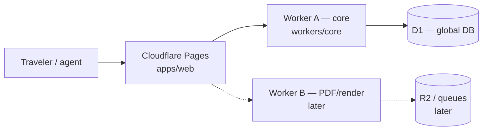

# ItineraryEdge

**Open-core edge visa itinerary engine** — generate embassy-style travel schedules and downloadable PDF packets on **Cloudflare** (Pages + Workers + D1).

> **Disclaimer:** PDFs and schedules produced by ItineraryEdge are **supporting travel packets only**. They are **not** visas, consular decisions, or guarantees of admission.

## Product

### Iteration 1 (scaffold)

- **Monorepo** with a Next.js App Router web shell (`apps/web`), **Worker A** API/core (`workers/core`), shared itinerary schema/types (`packages/shared`), and **D1 migrations** (`migrations/`).
- **Worker A** exposes `GET /health` for deploy and connectivity checks.

### Iteration 2 (create + persist)

- **Web routes:** `/`, `/itineraries/new`, `/itineraries`, `/itineraries/[id]`
- **Worker A API:** `POST /api/itineraries`, `GET /api/itineraries?email=`, `GET /api/itineraries/:id?email=`
- **Email-as-identity:** find or create `global_profiles` by email (no OTP / magic link).
- **Single traveler** drafts stored in D1 with `payload_json` TravelItinerary v1 (`is_premium_unlocked = 0`).
- Destination country is persisted on the itinerary row via the stay segment `location` inside `payload_json` (no extra D1 columns beyond Iteration 1).

**No Stripe**, no private premium repository, and no third-party premium dependencies in these iterations.

### Open core vs premium (roadmap)

| Layer | In this repo (open) | Premium / later |
| --- | --- | --- |
| Itinerary schema & types | ✅ `packages/shared` | Extended templates |
| Core Worker + D1 | ✅ `workers/core` | Worker B (async PDF/render pipeline) |
| Web UI shell | ✅ `apps/web` | Full editor + checkout UX |
| Payments | ❌ deferred | Stripe (not in Iteration 1) |
| Premium unlock | **Mock MVP** (`is_premium_unlocked` column, default `0`) | Real entitlement sync later |

**Stripe is intentionally deferred.** Iteration 1 stores premium state in D1 with `universal_itineraries.is_premium_unlocked` defaulting to `0`. A mock unlock path can flip the flag in a later iteration without payment processors.

**Worker B** (PDF generation, object storage, queues) is planned as a separate worker/service and is **not** part of Iteration 1.

## Architecture



- **Cloudflare Pages** hosts the Next.js App Router front end.
- **Worker A** (`itineraryedge-core`) is the edge API: health checks now; itinerary CRUD and ledger writes in later iterations.
- **D1** holds global profiles, itineraries (with premium flag), and a simple ledger for future billing/analytics events.

## Repository layout

```
apps/web/           Next.js App Router (Pages)
workers/core/       Worker A — /health, Wrangler + D1 binding stub
packages/shared/    JSON Schema + TypeScript types for itineraries
migrations/         D1 SQL migrations
.github/workflows/  CI (lint + typecheck)
```

## Self-host / BYOK

ItineraryEdge is designed to run on **your Cloudflare account**:

1. Fork or clone this repository.
2. Create a D1 database: `wrangler d1 create itineraryedge-global` and set `database_id` in `workers/core/wrangler.jsonc` (do **not** commit account secrets).
3. Apply migrations — see [`migrations/README.md`](migrations/README.md).
4. Deploy Worker A: `pnpm --filter @itineraryedge/core-worker deploy`.
5. Connect **Pages** to `apps/web` (Next.js preset) and set `NEXT_PUBLIC_CORE_WORKER_URL` to your Worker URL.

Bring your own keys (BYOK) for any future AI or email providers; Iteration 1 includes **no** external API keys.

## Development

Requirements: **Node 20+**, **pnpm 10+**.

```bash
pnpm install
pnpm lint
pnpm typecheck

# Terminal 1 — Worker A (default http://127.0.0.1:8787)
pnpm dev:core

# Terminal 2 — Web shell (http://localhost:3000)
pnpm dev:web
```

Health check: [`http://127.0.0.1:8787/health`](http://127.0.0.1:8787/health)

## License

MIT — see repository license file when added. Open-core premium features will remain outside this repository.
