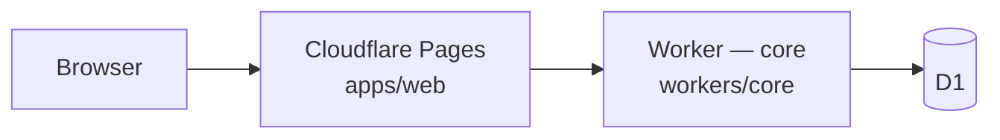

# ItineraryEdge

Monorepo for an edge-hosted travel itinerary API and web UI on **Cloudflare** (Pages, Workers, D1). It stores draft trip payloads, optional AI-generated flight/hotel/sightseeing JSON, and is intended for self-hosted experimentation.

> **Work in progress** — APIs and UI may change; not production-ready.

> **Disclaimer:** PDFs and schedules produced by ItineraryEdge are **supporting travel packets only**. They are **not** visas, consular decisions, or guarantees of admission.

## Architecture



| Piece | Role |
| --- | --- |
| `apps/web` | Next.js App Router UI |
| `workers/core` | HTTP API (`/health`, itinerary CRUD, `POST /api/itineraries/:id/generate`) |
| `packages/shared` | Shared types and validators |
| `migrations/` | D1 SQL migrations |

## Self-host / BYOK

Run on your own Cloudflare account:

1. Clone this repository.
2. Create D1: `wrangler d1 create itineraryedge-global` and set `database_id` in `workers/core/wrangler.jsonc` (do not commit account secrets).
3. Apply migrations — see [`migrations/README.md`](migrations/README.md).
4. Deploy the worker: `pnpm --filter @itineraryedge/core-worker deploy`.
5. Deploy **Pages** from `apps/web` and set `NEXT_PUBLIC_CORE_WORKER_URL` to the worker URL.

**BYOK (optional):** The web UI can store one AI key in **sessionStorage** only (`itineraryedge:byok:ai`). Generate requests send it as the `X-BYOK-Key` header; keys are not written to D1 or localStorage. On the worker, set `AI_PROVIDER` to `openai` or `anthropic`, and optionally `BYOK_AI_KEY` as a server-side fallback (use `wrangler secret put`, never commit). If no key is present in the session or environment, generation uses the **mock** driver.

## Development

Requirements: **Node 20+**, **pnpm 10+**.

```bash
pnpm install
pnpm lint
pnpm typecheck
pnpm test

# Terminal 1 — core worker (default http://127.0.0.1:8787)
pnpm dev:core

# Terminal 2 — web app (http://localhost:3000)
pnpm dev:web
```

Health check: [`http://127.0.0.1:8787/health`](http://127.0.0.1:8787/health)

## License

MIT — see the repository license file when present.
