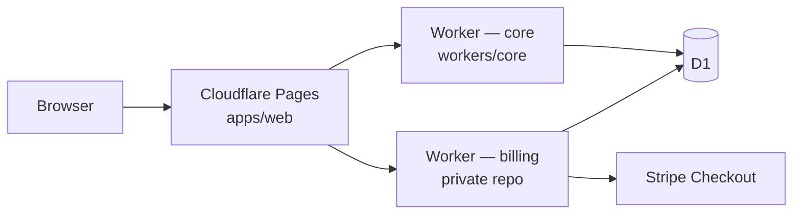

# ItineraryEdge

Monorepo for an edge-hosted travel itinerary API and web UI on **Cloudflare** (Pages, Workers, D1). It stores draft trip payloads, optional AI-generated flight/hotel/sightseeing JSON, and is intended for self-hosted experimentation.

> **Work in progress** — APIs and UI may change; not production-ready.

> **Disclaimer:** PDFs and schedules produced by ItineraryEdge are **supporting travel packets only**. They are **not** visas, consular decisions, or guarantees of admission.

## Architecture



| Piece | Role |
| --- | --- |
| `apps/web` | Next.js App Router UI |
| `workers/core` | HTTP API (`/health`, itinerary CRUD, generate, PDF, gated mock unlock) |
| `packages/shared` | Shared types, validators, geo **display** pricing |
| `migrations/` | D1 SQL migrations |
| **Worker B** ([`itineraryedge-billing`](https://github.com/lazehang/itineraryedge-billing)) | **Private** — Stripe Checkout, webhooks, writes `is_premium_unlocked` + ledger (not in this repo) |

## Self-host / BYOK

Run on your own Cloudflare account:

1. Clone this repository.
2. Create D1: `wrangler d1 create itineraryedge-global` and set `database_id` in `workers/core/wrangler.jsonc` (do not commit account secrets).
3. Apply migrations — see [`migrations/README.md`](migrations/README.md).
4. Deploy the worker: `pnpm --filter @itineraryedge/core-worker deploy`.
5. Deploy **Pages** from `apps/web` and set env vars (see below).

**BYOK (optional):** The web UI can store one AI key in **sessionStorage** only (`itineraryedge:byok:ai`). Generate requests send it as the `X-BYOK-Key` header; keys are not written to D1 or localStorage. On the worker, set `AI_PROVIDER` to `openai` or `anthropic`, and optionally `BYOK_AI_KEY` as a server-side fallback (use `wrangler secret put`, never commit). If no key is present in the session or environment, generation uses the **mock** driver.

### Travel packet PDFs (standard + polished unlock)

After **Generate packet** succeeds, the itinerary detail **Travel packet** card enables **Standard PDF** download. The worker compiles a multi-section PDF from stored flight, hotel, and sightseeing JSON (`GET /api/itineraries/:id/pdf?email=…`). If generation has not run, the API returns **409** with `code: "NOT_GENERATED"` and the UI keeps downloads disabled.

**Polished PDF** is a denser premium layout (cover page, QR placeholder, extra legal footer). It stays locked until `is_premium_unlocked` is set. Download via `GET …/pdf?variant=polished` or `GET …/pdf/polished`; if still locked, the API returns **403** with `code: "LOCKED"`.

Standard and polished PDFs repeat visa disclaimers — **supporting travel packets only**, not visas or official consular documents.

### Paid unlock vs mock (open core)

| Mode | Who sets unlock | UI |
| --- | --- | --- |
| **Production paid** | Worker B after Stripe webhook | **Pay to unlock** → Stripe Checkout on billing worker; return URLs on Pages (`?checkout=success\|cancel`) |
| **Staging mock** | Core worker `POST …/unlock-mock` when `ALLOW_MOCK_UNLOCK=1` | Secondary **Demo unlock (staging)** + **Test checkout** chip |
| **Self-host without billing** | Optional mock locally, or open PDF only | Leave billing URL unset; enable mock only in non-prod |

Geo **display** pricing on the web (actual charge is on Worker B): **Hong Kong → HK$70**, **Eurozone → €9**, **else → $9 USD**. If destination country is unknown, the UI shows **Price shown at checkout**.

**No Stripe secret keys, webhook secrets, or Stripe SDK server code belong in this public repository.**

### Environment variables

Set these on **Cloudflare Pages** (`apps/web`) after your first deploy (placeholders until then):

| Variable | Where | Purpose |
| --- | --- | --- |
| `NEXT_PUBLIC_CORE_WORKER_URL` | Pages | Core API base URL (required) |
| `NEXT_PUBLIC_APP_URL` | Pages | Public site origin for checkout return URLs, e.g. `https://your-project.pages.dev` |
| `NEXT_PUBLIC_BILLING_WORKER_URL` | Pages | Public Worker B base URL for `POST /api/checkout/session` (paid unlock) |
| `NEXT_PUBLIC_ALLOW_MOCK_UNLOCK` | Pages | Set to `1` only in local/staging to show demo unlock UI |

Core worker (`workers/core`) vars / secrets:

| Variable | Purpose |
| --- | --- |
| `ALLOW_MOCK_UNLOCK` | Set to `1` to allow `POST /api/itineraries/:id/unlock-mock` (local/staging only) |
| `AI_PROVIDER`, `BYOK_AI_KEY` | Optional AI generation (see BYOK above) |

**Billing worker (private repo):** configure Stripe keys, webhook signing secret, and the same D1 binding there. Webhooks should write ledger rows with unique `stripe_checkout_session_id` / `stripe_event_id` (columns added in migration `0004`) and set `is_premium_unlocked` on the itinerary. See `itineraryedge-billing` for staging webhook setup — do not expose production webhook endpoints in this README.

### Checkout API contract (Worker B)

The web app calls (no auth headers beyond email in body — Worker B must enforce ownership):

```http
POST {NEXT_PUBLIC_BILLING_WORKER_URL}/api/checkout/session
Content-Type: application/json

{
  "itineraryId": "…",
  "email": "…",
  "successUrl": "{NEXT_PUBLIC_APP_URL}/itineraries/{id}?email=…&checkout=success",
  "cancelUrl": "{NEXT_PUBLIC_APP_URL}/itineraries/{id}?email=…&checkout=cancel",
  "destinationCountry": "JP"
}
```

Response: `{ "checkoutUrl": "https://checkout.stripe.com/…" }` (or `{ "url": "…" }`).

## Development

Requirements: **Node 20+**, **pnpm 10+**.

```bash
pnpm install
pnpm lint
pnpm typecheck
pnpm test

# Terminal 1 — core worker (default http://127.0.0.1:8787)
pnpm dev:core

# Terminal 2 — web app (http://localhost:3000)
pnpm dev:web
```

Local staging-style unlock (no Stripe):

```bash
# workers/core — e.g. wrangler.jsonc vars: { "ALLOW_MOCK_UNLOCK": "1" }
# apps/web — NEXT_PUBLIC_ALLOW_MOCK_UNLOCK=1 in .env.local
```

Health check: [`http://127.0.0.1:8787/health`](http://127.0.0.1:8787/health)

## License

MIT — see the repository license file when present.
