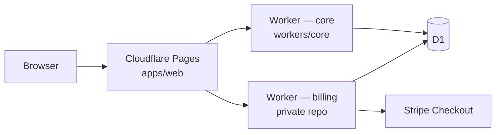

# Architecture

ItineraryEdge is an **open-core** monorepo: the public repository ships the web UI, core API worker, shared types, and D1 migrations. **Payment and Stripe integration** live in a separate private billing worker (Worker B).

## High-level diagram

## Components

| Piece | Location | Role |
| --- | --- | --- |
| Web UI | `apps/web` | Next.js App Router; talks to core (and optionally billing) over HTTPS |
| Core worker | `workers/core` | Public HTTP API: health, itinerary CRUD, AI generation, PDF compile, gated mock unlock |
| Shared package | `packages/shared` | Types, validators, geo **display** pricing helpers |
| Migrations | `migrations/` | D1 schema for profiles, itineraries, ledger (including Stripe id columns for Worker B) |
| Billing worker | [`itineraryedge-billing`](https://github.com/lazehang/itineraryedge-billing) | **Private** — creates Checkout sessions, verifies webhooks, sets `is_premium_unlocked` and ledger rows |

## Data and identity

- **D1** (`itineraryedge-global`) holds profiles (keyed by normalized email), itinerary drafts, generation JSON, unlock state, and a ledger for unlock events.
- **Email-as-identity (MVP):** The core API scopes access with a query parameter `email` (see [security.md](./security.md)). There is no OAuth or session cookie on the core worker in this iteration.

## BYOK generation

Optional **bring-your-own-key** AI: the browser may send `X-BYOK-Key` on generate requests; keys stay in sessionStorage on the client or in Wrangler secrets on the server. Without a key, the **mock** driver produces deterministic sample JSON.

## Travel packet PDFs

After generation, the core worker builds PDFs with **pdf-lib** from stored flight, hotel, and sightseeing JSON:

- **Standard** — always available once generation exists.
- **Polished** — premium layout; requires `is_premium_unlocked` (mock unlock in staging, or Worker B after paid checkout in production).

Both variants embed visa/travel disclaimers in the PDF body.

## What stays out of the public repo

No Stripe secret keys, webhook signing secrets, or Stripe SDK server code belong in this repository. The [checkout contract](./checkout-contract.md) documents only the cross-service HTTP shape.
